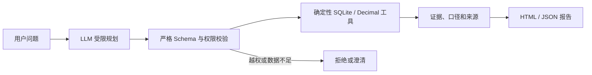

# Evidence Workbench｜经营数据复核与分析助手

一个面向零售/电商运营负责人和分析师的、可复现的本地数据分析工作流。它把自然语言问题转换为受限任务计划，再由确定性数据工具计算经营指标、贡献拆解和质量清单；模型不能直接生成经营数字，也不能执行任意 SQL、代码或写操作。

当前版本是求职作品和本地原型，不是已部署的多用户企业系统，也没有经过真实企业客户试点。公开历史数据上的实验不能证明节省了多少人工时间或产生了多少业务收益。

## 能解决什么

- 月度正向交易、取消记录和有效交易净额概览；
- 相邻月份对比以及国家、商品变化贡献；
- 缺失、重复候选、非正价格等数据质量提示；
- 对利润、转化率、真实退款率等缺少必要字段的问题明确返回 `unsupported`；
- 保存输入版本、口径、计划、计算结果和回放证据。

## 工作流



- **B0**：固定 SQL 聚合，作为数值对照路径。
- **B1**：Decimal 聚合、质量检查、证据报告和只读回放。
- **B2**：模型只负责选择受限任务；后端完成参数、权限、预算和结果校验。

B0/B1/B2 是本项目内部的对照名称，不是行业成熟度等级。

## 已有证据

- UCI Online Retail：541,909 条公开历史交易；
- SQL 与 Decimal：65/65 项数值一致；
- B2 调优后建立的保留集：8/8 通过，0 次修复；
- 最终保留集运行回放：23/23 通过，0 次模型调用；
- 本地完整回归：122/122 通过；
- 66 次真实模型请求的费用保守上界：0.1953702 元人民币，不等于账单实扣；
- 数据边界、开发集调优和首次失败均保留，不把小型自建评测写成通用准确率 100%。

静态演示：

- [经营分析报告](docs/demo/retail-report.html)
- [B2 保留集摘要](docs/demo/b2-evaluation.html)

## 快速开始

### 1. 只运行合成样例

```powershell
python -m venv .venv
.venv\Scripts\python -m pip install -r requirements-lock.txt
.venv\Scripts\python -m b1 demo
```

Linux/macOS 将解释器路径改为 `.venv/bin/python`。命令会创建 `runs/<运行ID>/report.html`。

### 2. 复现 UCI 真实数据案例

数据不随仓库重复分发。脚本从 UCI 官方地址获取 CC BY 4.0 数据，并用清单和 SHA-256 绑定本地快照。

```powershell
.venv\Scripts\python -m pip install -r requirements-data.txt
.venv\Scripts\python scripts/acquire_retail.py
.venv\Scripts\python scripts/prepare_retail.py
.venv\Scripts\python -m b1 retail
```

### 3. 离线回归

```powershell
.venv\Scripts\python scripts/evaluate.py
```

没有真实数据快照时，相关集成测试会明确标记为 skipped；GitHub Actions 会先获取固定公开数据再运行完整回归。

### 4. 可选 B2 模型规划

复制 `.env.b2.example` 中的变量名到当前进程，不要把真实密钥写入文件或提交到 Git。支持 DeepSeek 官方接口，也支持配置 OpenAI-compatible 网关。

```powershell
$env:DEEPSEEK_API_KEY = '<仅在本机设置>'
.venv\Scripts\python -m b2 live --question '2011年11月相比10月，有效交易净额变化多少？'
```

硅基流动示例可使用：

```powershell
.\run_b2_siliconflow.ps1 -Mode live -Question '2011年11月经营情况怎么样？'
```

该脚本不包含个人凭据路径。调用前请在当前进程设置 `B2_API_KEY`，或设置指向本机 DPAPI 文件的 `B2_DPAPI_KEY_FILE`。

## 数据与许可证

- 项目原创代码：MIT License，见 [LICENSE](LICENSE)。
- UCI Online Retail：Chen, D. (2015)，DOI `10.24432/C5BW33`，CC BY 4.0。
- Many Labs 1 数据：CC0；固定上游 commit `7a1334c053201ccdd2054417f74aa3d62776dd03`。
- Many Labs 1 作者代码：GPL-3.0，仅作为固定上游研究材料获取和审查，不并入本项目原创代码。

完整说明见 [THIRD_PARTY_NOTICES.md](THIRD_PARTY_NOTICES.md)。原始数据、准备数据库、虚拟环境、运行目录和密钥均不进入仓库。

## 安全与边界

- 只读分析，不修改源数据；
- 模型不获得任意 SQL、Python 或文件写入能力；
- 计划必须通过严格字段、枚举、时间范围和任务权限校验；
- 预算跨运行累计，达到硬上限时拒绝继续调用；
- API 密钥只从进程环境或 Windows 当前用户 DPAPI 文件读取；
- 报告中的“净额”是本项目定义，不是 GAAP/IFRS 收入，也不等于现金退款。

安全报告方式见 [SECURITY.md](SECURITY.md)。

## 可复用与继续改进

可复用部分是“受限规划 + 确定性计算 + 证据回放”的工作流，不是把 UCI 字段硬套到所有企业。后续可通过版本化迭代加入：

- 企业字段映射和数据契约；
- 本地 Web 界面；
- 带权限、版本和引用的知识库适配器；
- 多用户认证、监控和真实业务试点；
- 同一用户手工/B1/B2耗时与纠错对照。

每次改进应新增测试、评测证据和版本说明；Git 历史与 release tag 用于保留旧版本，不会因为公开 v1.0 而停止迭代。
